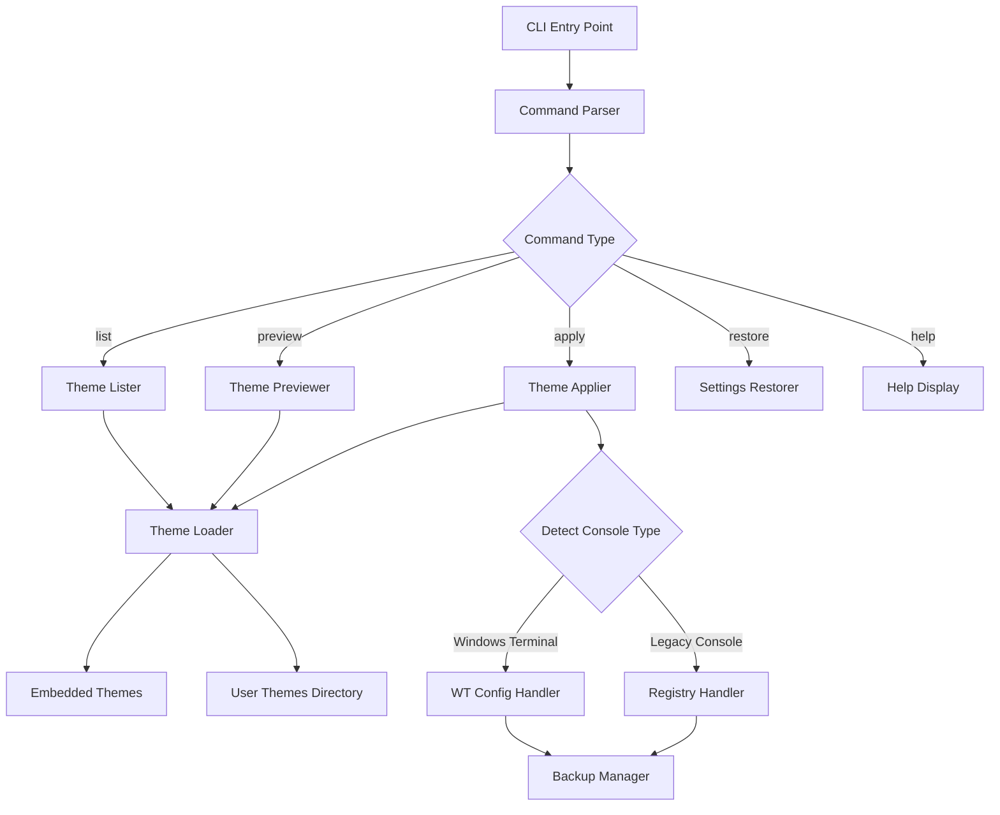

# Design Document: CMD Theme Pack

## Overview

The CMD Theme Pack is a command-line utility that manages and applies color schemes to Windows Command Prompt environments. The tool provides a curated collection of themes and a simple CLI interface for browsing, previewing, and applying themes by modifying Windows console configuration through registry settings (legacy console) or Windows Terminal's JSON configuration files.

### Core Design Principles

1. **Zero Dependencies for End Users**: Ship as a single executable with embedded themes
2. **Non-Destructive**: Always backup current settings before modifications
3. **Cross-Version Support**: Handle both legacy console (registry) and Windows Terminal (JSON) configurations
4. **Fail-Safe**: Validate all inputs and provide clear error messages
5. **Performance**: Fast startup and execution for CLI operations

### Technology Stack

**Implementation Language**: Rust
- Memory safety without garbage collection
- Excellent Windows API support via `winapi` and `windows` crates
- Single-executable compilation with embedded resources
- Strong type system for configuration validation
- Cross-compilation support for future portability

**Key Libraries**:
- `serde` and `serde_json`: JSON parsing/serialization for theme files and Windows Terminal config
- `winreg`: Windows registry operations for legacy console
- `clap`: Command-line argument parsing with auto-generated help
- `colored`: Terminal output formatting for preview mode
- `dirs`: Platform-specific directory detection

## Architecture

### High-Level Architecture



### Component Interaction Flow

1. **Startup**: Parse command-line arguments and validate command
2. **Theme Loading**: Load embedded themes + scan user themes directory
3. **Command Execution**: Execute requested operation (list/preview/apply/restore)
4. **Configuration Detection**: Determine console type (Windows Terminal vs legacy)
5. **Backup Creation**: Create backup before any modifications
6. **Application**: Write theme colors to appropriate configuration location
7. **Verification**: Confirm changes and display success/error messages

## Components and Interfaces

### 1. Theme Loader (`theme_loader.rs`)

**Responsibility**: Load, parse, and validate theme files from embedded resources and filesystem

**Public Interface**:
```rust
pub struct ThemeLoader {
    embedded_themes: HashMap<String, Theme>,
    user_themes: HashMap<String, Theme>,
}

impl ThemeLoader {
    pub fn new() -> Result<Self, ThemeError>;
    pub fn load_all_themes(&mut self) -> Result<(), ThemeError>;
    pub fn get_theme(&self, name: &str) -> Option<&Theme>;
    pub fn list_themes(&self) -> Vec<&Theme>;
    pub fn validate_theme(&self, theme: &Theme) -> Result<(), ValidationError>;
}
```

**Implementation Details**:
- Embedded themes compiled into binary using `include_str!` macro at build time
- User themes loaded from `%LOCALAPPDATA%\cmd-theme-pack\themes\` directory
- Theme deduplication: user themes override embedded themes with same name
- Validation on load: check all required fields and color format

### 2. Theme Structure (`theme.rs`)

**Data Model**:
```rust
#[derive(Debug, Clone, Serialize, Deserialize)]
pub struct Theme {
    pub schema_version: String,
    pub name: String,
    pub description: String,
    pub author: String,
    pub palette_type: PaletteType,  // Dark or Light
    pub colors: ColorScheme,
}

#[derive(Debug, Clone, Serialize, Deserialize)]
pub enum PaletteType {
    Dark,
    Light,
}

#[derive(Debug, Clone, Serialize, Deserialize)]
pub struct ColorScheme {
    pub background: String,    // Hex: #RRGGBB
    pub foreground: String,    // Hex: #RRGGBB
    pub black: String,
    pub red: String,
    pub green: String,
    pub yellow: String,
    pub blue: String,
    pub magenta: String,
    pub cyan: String,
    pub white: String,
    pub bright_black: String,
    pub bright_red: String,
    pub bright_green: String,
    pub bright_yellow: String,
    pub bright_blue: String,
    pub bright_magenta: String,
    pub bright_cyan: String,
    pub bright_white: String,
}
```

**Theme File Format** (JSON):
```json
{
  "schema_version": "1.0",
  "name": "Dracula",
  "description": "A dark theme with purple accents",
  "author": "Dracula Theme",
  "palette_type": "Dark",
  "colors": {
    "background": "#282a36",
    "foreground": "#f8f8f2",
    "black": "#21222c",
    "red": "#ff5555",
    "green": "#50fa7b",
    "yellow": "#f1fa8c",
    "blue": "#bd93f9",
    "magenta": "#ff79c6",
    "cyan": "#8be9fd",
    "white": "#f8f8f2",
    "bright_black": "#6272a4",
    "bright_red": "#ff6e6e",
    "bright_green": "#69ff94",
    "bright_yellow": "#ffffa5",
    "bright_blue": "#d6acff",
    "bright_magenta": "#ff92df",
    "bright_cyan": "#a4ffff",
    "bright_white": "#ffffff"
  }
}
```

### 3. Console Detector (`console_detector.rs`)

**Responsibility**: Detect which console system is in use (Windows Terminal vs legacy console)

**Public Interface**:
```rust
pub enum ConsoleType {
    WindowsTerminal { settings_path: PathBuf },
    LegacyConsole,
    Unknown,
}

pub struct ConsoleDetector;

impl ConsoleDetector {
    pub fn detect() -> ConsoleType;
    fn is_windows_terminal_installed() -> bool;
    fn get_windows_terminal_settings_path() -> Option<PathBuf>;
}
```

**Detection Algorithm**:
1. Check if Windows Terminal is installed by looking for settings.json in standard locations:
   - `%LOCALAPPDATA%\Packages\Microsoft.WindowsTerminal_8wekyb3d8bbwe\LocalState\settings.json`
   - `%LOCALAPPDATA%\Microsoft\Windows Terminal\settings.json` (unpackaged)
2. If Windows Terminal detected and settings.json exists → `WindowsTerminal`
3. Otherwise → `LegacyConsole`

### 4. Windows Terminal Handler (`wt_handler.rs`)

**Responsibility**: Read and modify Windows Terminal settings.json

**Public Interface**:
```rust
pub struct WindowsTerminalHandler {
    settings_path: PathBuf,
}

impl WindowsTerminalHandler {
    pub fn new(settings_path: PathBuf) -> Self;
    pub fn apply_theme(&self, theme: &Theme) -> Result<(), ApplyError>;
    pub fn get_current_scheme(&self) -> Result<Option<String>, ReadError>;
    fn read_settings(&self) -> Result<Value, ReadError>;
    fn write_settings(&self, settings: Value) -> Result<(), WriteError>;
    fn add_or_update_scheme(&self, settings: &mut Value, theme: &Theme);
}
```

**Implementation Details**:
- Parse existing settings.json preserving all user configuration
- Add or update color scheme in the `schemes` array
- Convert theme format to Windows Terminal format:
  ```json
  {
    "name": "Dracula",
    "background": "#282a36",
    "foreground": "#f8f8f2",
    "black": "#21222c",
    "red": "#ff5555",
    ...
  }
  ```
- Optionally set as default scheme in `defaults.colorScheme`
- Pretty-print JSON output with 4-space indentation

### 5. Registry Handler (`registry_handler.rs`)

**Responsibility**: Read and modify Windows Console registry settings

**Public Interface**:
```rust
pub struct RegistryHandler {
    console_key_path: String,
}

impl RegistryHandler {
    pub fn new() -> Self;
    pub fn apply_theme(&self, theme: &Theme) -> Result<(), ApplyError>;
    pub fn read_current_colors(&self) -> Result<ConsoleColors, ReadError>;
    fn write_color_table(&self, colors: &ColorScheme) -> Result<(), WriteError>;
    fn hex_to_colorref(&self, hex: &str) -> Result<u32, ColorError>;
}
```

**Implementation Details**:
- Registry path: `HKEY_CURRENT_USER\Console`
- Color values stored as DWORD in BGR format: `0x00BBGGRR`
- ColorTable entries: `ColorTable00` through `ColorTable15`
  - ColorTable00-07: black, blue, green, cyan, red, magenta, yellow, white
  - ColorTable08-15: bright variants
- Additional registry values:
  - `ScreenColors`: DWORD combining foreground/background indices
  - Format: `0x00BF` where B=background index (0-15), F=foreground index (0-15)

**Color Conversion**:
```rust
fn hex_to_colorref(hex: &str) -> Result<u32, ColorError> {
    // Parse "#RRGGBB" to RGB
    let r = u32::from_str_radix(&hex[1..3], 16)?;
    let g = u32::from_str_radix(&hex[3..5], 16)?;
    let b = u32::from_str_radix(&hex[5..7], 16)?;
    
    // Convert to BGR DWORD format
    Ok((b << 16) | (g << 8) | r)
}
```

**Registry Mapping**:
| Theme Color | Registry Key | Index |
|------------|--------------|-------|
| black | ColorTable00 | 0 |
| blue | ColorTable01 | 1 |
| green | ColorTable02 | 2 |
| cyan | ColorTable03 | 3 |
| red | ColorTable04 | 4 |
| magenta | ColorTable05 | 5 |
| yellow | ColorTable06 | 6 |
| white | ColorTable07 | 7 |
| bright_black | ColorTable08 | 8 |
| bright_blue | ColorTable09 | 9 |
| bright_green | ColorTable10 | 10 |
| bright_cyan | ColorTable11 | 11 |
| bright_red | ColorTable12 | 12 |
| bright_magenta | ColorTable13 | 13 |
| bright_yellow | ColorTable14 | 14 |
| bright_white | ColorTable15 | 15 |

### 6. Backup Manager (`backup_manager.rs`)

**Responsibility**: Create and restore backups of console settings

**Public Interface**:
```rust
pub struct BackupManager {
    backup_dir: PathBuf,
}

impl BackupManager {
    pub fn new() -> Result<Self, BackupError>;
    pub fn create_backup(&self, console_type: &ConsoleType) -> Result<(), BackupError>;
    pub fn restore_backup(&self, console_type: &ConsoleType) -> Result<(), RestoreError>;
    pub fn backup_exists(&self) -> bool;
    fn get_backup_path(&self, console_type: &ConsoleType) -> PathBuf;
}
```

**Implementation Details**:
- Backup directory: `%LOCALAPPDATA%\cmd-theme-pack\backups\`
- Backup files:
  - Windows Terminal: `wt_backup.json` (copy of settings.json)
  - Legacy Console: `console_backup.json` (registry values exported to JSON)
- Only create backup on first `apply` operation (check if backup exists)
- Restore operation replaces current settings with backup content

### 7. Theme Previewer (`previewer.rs`)

**Responsibility**: Display visual preview of theme in terminal

**Public Interface**:
```rust
pub struct ThemePreviewer;

impl ThemePreviewer {
    pub fn preview_theme(theme: &Theme);
    fn display_color_palette(colors: &ColorScheme);
    fn display_sample_content(colors: &ColorScheme);
}
```

**Preview Output Format**:
```
╔══════════════════════════════════════════════════════════╗
║  Theme: Dracula                                          ║
║  Description: A dark theme with purple accents           ║
║  Author: Dracula Theme                                   ║
║  Type: Dark                                              ║
╚══════════════════════════════════════════════════════════╝

Color Palette:
  ■ Black       #21222c    ■ Bright Black   #6272a4
  ■ Red         #ff5555    ■ Bright Red     #ff6e6e
  ■ Green       #50fa7b    ■ Bright Green   #69ff94
  ■ Yellow      #f1fa8c    ■ Bright Yellow  #ffffa5
  ■ Blue        #bd93f9    ■ Bright Blue    #d6acff
  ■ Magenta     #ff79c6    ■ Bright Magenta #ff92df
  ■ Cyan        #8be9fd    ■ Bright Cyan    #a4ffff
  ■ White       #f8f8f2    ■ Bright White   #ffffff

Sample Output:
  > dir C:\Windows
  Directory of C:\Windows
  01/15/2024  10:30 AM    <DIR>          System32
  01/15/2024  10:30 AM    <DIR>          SysWOW64
  [SUCCESS] Operation completed successfully
  [WARNING] Low disk space
  [ERROR] File not found
```

### 8. CLI Handler (`cli.rs`)

**Responsibility**: Parse command-line arguments and route to appropriate handlers

**Command Structure**:
```rust
use clap::{Parser, Subcommand};

#[derive(Parser)]
#[command(name = "cmd-theme")]
#[command(about = "Manage and apply CMD color themes", long_about = None)]
struct Cli {
    #[command(subcommand)]
    command: Commands,
}

#[derive(Subcommand)]
enum Commands {
    /// List all available themes
    List,
    
    /// Preview a theme without applying it
    Preview {
        /// Theme name to preview
        theme_name: String,
    },
    
    /// Apply a theme to the console
    Apply {
        /// Theme name to apply
        theme_name: String,
        
        /// Skip backup creation
        #[arg(long)]
        no_backup: bool,
    },
    
    /// Restore console settings from backup
    Restore,
    
    /// Display help information
    Help,
}
```

## Data Models

### Color Validation

**Color Format**: Hexadecimal RGB `#RRGGBB`

**Validation Rules**:
```rust
fn validate_hex_color(color: &str) -> Result<(), ValidationError> {
    // Must start with #
    if !color.starts_with('#') {
        return Err(ValidationError::MissingHash);
    }
    
    // Must be exactly 7 characters (#RRGGBB)
    if color.len() != 7 {
        return Err(ValidationError::InvalidLength);
    }
    
    // Characters 1-6 must be valid hex
    for c in color[1..].chars() {
        if !c.is_ascii_hexdigit() {
            return Err(ValidationError::InvalidHexCharacter);
        }
    }
    
    Ok(())
}
```

### Error Types

```rust
#[derive(Debug, thiserror::Error)]
pub enum ThemeError {
    #[error("Theme not found: {0}")]
    NotFound(String),
    
    #[error("Invalid theme file: {0}")]
    InvalidFormat(String),
    
    #[error("IO error: {0}")]
    Io(#[from] std::io::Error),
    
    #[error("JSON parsing error: {0}")]
    Json(#[from] serde_json::Error),
}

#[derive(Debug, thiserror::Error)]
pub enum ApplyError {
    #[error("Failed to write registry: {0}")]
    RegistryWrite(String),
    
    #[error("Failed to write settings file: {0}")]
    FileWrite(String),
    
    #[error("Insufficient permissions. Run as administrator.")]
    PermissionDenied,
    
    #[error("Backup creation failed: {0}")]
    BackupFailed(String),
}

#[derive(Debug, thiserror::Error)]
pub enum ValidationError {
    #[error("Missing required field: {0}")]
    MissingField(String),
    
    #[error("Invalid color format: {0}")]
    InvalidColor(String),
    
    #[error("Invalid schema version: expected {expected}, got {actual}")]
    InvalidSchemaVersion { expected: String, actual: String },
}
```

## Error Handling

### Error Handling Strategy

1. **Fail Fast**: Validate all inputs before making any changes
2. **Descriptive Errors**: Provide clear, actionable error messages
3. **Rollback on Failure**: If backup exists and apply fails, offer to restore
4. **Graceful Degradation**: Skip invalid themes during loading, log warnings

### Permission Handling

**Registry Write Permissions**:
- Writing to `HKCU\Console` typically doesn't require administrator privileges
- If write fails with permission error:
  ```
  ERROR: Failed to apply theme - insufficient permissions
  
  The registry could not be modified. This usually indicates a permission issue.
  Try running cmd-theme from an elevated command prompt (Run as Administrator).
  ```

**File Write Permissions**:
- Windows Terminal settings.json should be user-writable
- If write fails:
  ```
  ERROR: Failed to write Windows Terminal settings
  
  Location: C:\Users\...\LocalState\settings.json
  Cause: Permission denied
  
  Ensure Windows Terminal is not running and you have write access to the file.
  ```

### Validation Error Messages

**Missing Theme**:
```
ERROR: Theme 'nonexistent' not found

Available themes:
  - Dracula
  - Solarized Dark
  - Monokai
  - Nord
  ...

Use 'cmd-theme list' to see all available themes.
```

**Invalid Theme File**:
```
ERROR: Failed to load theme from 'custom-theme.json'

Validation errors:
  - Missing required field: 'foreground'
  - Invalid color format at 'colors.red': '255,0,0' (expected #RRGGBB)
  - Invalid schema version: expected '1.0', got '2.0'

Please fix these issues and try again.
```

## Testing Strategy

### Unit Testing Approach

**Core Functionality Tests**:
1. **Color Conversion Tests**:
   - Test hex to BGR DWORD conversion
   - Test RGB to hex conversion
   - Test edge cases (white #FFFFFF, black #000000)

2. **Theme Validation Tests**:
   - Test valid theme structure
   - Test missing required fields
   - Test invalid color formats
   - Test schema version validation

3. **Theme Loading Tests**:
   - Test embedded theme loading
   - Test user theme directory scanning
   - Test theme deduplication (user overrides embedded)
   - Test graceful handling of invalid themes

4. **Registry Operations Tests** (Windows-specific):
   - Test reading ColorTable values
   - Test writing ColorTable values
   - Test ScreenColors calculation
   - Mock registry for cross-platform CI

5. **Windows Terminal JSON Tests**:
   - Test parsing existing settings.json
   - Test adding new color scheme
   - Test updating existing color scheme
   - Test preserving user configuration

6. **Backup/Restore Tests**:
   - Test backup creation
   - Test backup existence check
   - Test restore from backup
   - Test handling missing backup

**Example Unit Test**:
```rust
#[cfg(test)]
mod tests {
    use super::*;

    #[test]
    fn test_hex_to_colorref() {
        // Red #FF0000 -> 0x000000FF
        assert_eq!(hex_to_colorref("#FF0000").unwrap(), 0x000000FF);
        
        // Green #00FF00 -> 0x0000FF00
        assert_eq!(hex_to_colorref("#00FF00").unwrap(), 0x0000FF00);
        
        // Blue #0000FF -> 0x00FF0000
        assert_eq!(hex_to_colorref("#0000FF").unwrap(), 0x00FF0000);
        
        // White #FFFFFF -> 0x00FFFFFF
        assert_eq!(hex_to_colorref("#FFFFFF").unwrap(), 0x00FFFFFF);
        
        // Black #000000 -> 0x00000000
        assert_eq!(hex_to_colorref("#000000").unwrap(), 0x00000000);
    }

    #[test]
    fn test_theme_validation() {
        let valid_theme = Theme {
            schema_version: "1.0".to_string(),
            name: "Test".to_string(),
            description: "Test theme".to_string(),
            author: "Test Author".to_string(),
            palette_type: PaletteType::Dark,
            colors: ColorScheme {
                background: "#000000".to_string(),
                foreground: "#FFFFFF".to_string(),
                // ... all other colors
            },
        };
        
        assert!(validate_theme(&valid_theme).is_ok());
    }

    #[test]
    fn test_invalid_color_format() {
        assert!(validate_hex_color("FF0000").is_err());  // Missing #
        assert!(validate_hex_color("#FF00").is_err());    // Too short
        assert!(validate_hex_color("#GGGGGG").is_err());  // Invalid hex
        assert!(validate_hex_color("#FF0000").is_ok());   // Valid
    }
}
```

### Integration Testing

**Integration Test Scenarios**:
1. **End-to-End Theme Application**:
   - Load themes → Select theme → Apply → Verify configuration changed
   - Test both Windows Terminal and legacy console paths

2. **Backup and Restore Flow**:
   - Apply theme → Verify backup created → Restore → Verify original state

3. **User Theme Loading**:
   - Create custom theme file → Load themes → Verify custom theme available

4. **Error Recovery**:
   - Apply theme with invalid registry access → Verify no partial changes
   - Apply theme with corrupt settings.json → Verify error handling

**Test Environment Setup**:
- Use temporary directories for settings and backups
- Mock registry operations on non-Windows platforms
- Provide sample theme files for testing

### Manual Testing Checklist

**Windows 10 Testing**:
- [ ] Detect legacy console correctly
- [ ] Apply theme to registry
- [ ] Verify colors in new CMD window
- [ ] Restore backup successfully

**Windows 11 with Windows Terminal**:
- [ ] Detect Windows Terminal correctly
- [ ] Apply theme to settings.json
- [ ] Verify scheme appears in Windows Terminal
- [ ] Preserve existing user configuration

**Cross-Version Testing**:
- [ ] Windows 10 without Windows Terminal
- [ ] Windows 10 with Windows Terminal installed
- [ ] Windows 11 (Windows Terminal default)

**Error Scenarios**:
- [ ] Apply non-existent theme
- [ ] Restore without backup
- [ ] Run without admin when needed
- [ ] Handle corrupt theme file
- [ ] Handle corrupt settings.json

## Curated Theme Collection

### Initial Theme Pack (10 Themes)

1. **Dracula** (Dark)
   - Background: `#282a36`, Foreground: `#f8f8f2`
   - Purple and pink accents, high contrast
   - Source: https://draculatheme.com/

2. **Solarized Dark** (Dark)
   - Background: `#002b36`, Foreground: `#839496`
   - Carefully selected contrast ratios
   - Source: https://ethanschoonover.com/solarized/

3. **Solarized Light** (Light)
   - Background: `#fdf6e3`, Foreground: `#657b83`
   - Light variant of Solarized

4. **Monokai** (Dark)
   - Background: `#272822`, Foreground: `#f8f8f2`
   - Warm color scheme, popular in Sublime Text

5. **Nord** (Dark)
   - Background: `#2e3440`, Foreground: `#d8dee9`
   - Arctic, north-bluish color palette

6. **One Dark** (Dark)
   - Background: `#282c34`, Foreground: `#abb2bf`
   - Inspired by Atom's One Dark theme

7. **One Light** (Light)
   - Background: `#fafafa`, Foreground: `#383a42`
   - Light variant of One Dark

8. **Gruvbox Dark** (Dark)
   - Background: `#282828`, Foreground: `#ebdbb2`
   - Retro groove colors, warm

9. **Tokyo Night** (Dark)
   - Background: `#1a1b26`, Foreground: `#c0caf5`
   - Clean, modern, dark blue theme

10. **GitHub Light** (Light)
    - Background: `#ffffff`, Foreground: `#24292f`
    - Clean, minimal, GitHub-inspired

### Theme Sources and Attribution

All themes will include proper attribution in theme metadata:
- Author name
- Original source URL (if applicable)
- License information (most terminal themes are MIT licensed)

### Theme File Organization

**Embedded Themes**:
- Located in `src/themes/` directory during development
- Embedded at compile time using `include_str!` macro
- Ensures zero external dependencies for distribution

**User Themes Directory**:
- Location: `%LOCALAPPDATA%\cmd-theme-pack\themes\`
- Created on first run if it doesn't exist
- Users can add custom `.json` theme files here
- README.txt in directory explaining format

## Deployment and Packaging

### Build Configuration

**Cargo.toml**:
```toml
[package]
name = "cmd-theme"
version = "1.0.0"
edition = "2021"
authors = ["CMD Theme Pack Contributors"]

[dependencies]
serde = { version = "1.0", features = ["derive"] }
serde_json = "1.0"
clap = { version = "4.0", features = ["derive"] }
colored = "2.0"
dirs = "5.0"
thiserror = "1.0"

[target.'cfg(windows)'.dependencies]
winreg = "0.52"
windows = { version = "0.54", features = ["Win32_System_Registry"] }

[profile.release]
strip = true
lto = true
codegen-units = 1
opt-level = "z"  # Optimize for size
```

### Build Process

**Release Build**:
```bash
cargo build --release --target x86_64-pc-windows-msvc
```

**Output**: Single executable `cmd-theme.exe` (~2-3 MB after optimization)

### Distribution

**Installation**:
1. Download `cmd-theme.exe`
2. Place in PATH directory (e.g., `C:\Windows\System32` or user's `bin` folder)
3. Run `cmd-theme help` to verify installation

**Uninstallation**:
1. Delete `cmd-theme.exe`
2. Optionally delete `%LOCALAPPDATA%\cmd-theme-pack\` directory (themes and backups)

### Versioning and Updates

**Semantic Versioning**: `MAJOR.MINOR.PATCH`
- MAJOR: Breaking changes to theme format or CLI interface
- MINOR: New features (new themes, commands)
- PATCH: Bug fixes, theme updates

**Update Mechanism**: Manual (initial version)
- Users download new executable to replace old version
- Future: Add `cmd-theme update` command with self-update capability

## Security Considerations

### Registry Access

**Risk**: Modifying registry could affect system stability
**Mitigation**:
- Only modify `HKCU\Console` (user-specific, not system-wide)
- Validate all values before writing
- Create backup before any modifications
- Use Windows API correctly (no raw registry manipulation)

### File System Access

**Risk**: Reading/writing Windows Terminal settings.json
**Mitigation**:
- Only read/write known locations
- Validate JSON structure before writing
- Preserve all existing configuration (only modify schemes)
- Handle file locking gracefully (Windows Terminal may have file open)

### Theme File Validation

**Risk**: Malicious or malformed theme files
**Mitigation**:
- Strict JSON schema validation
- Reject themes with invalid color values
- Sandbox theme loading (don't execute code)
- Limit theme file size (reasonable JSON size)

### Input Validation

**Risk**: Command injection or path traversal
**Mitigation**:
- Use structured argument parsing (clap)
- Validate theme names (alphanumeric + dash/underscore only)
- No shell command execution based on user input
- Sanitize all file paths

## Performance Considerations

### Startup Time

**Target**: < 50ms for most operations
**Optimization**:
- Lazy loading of themes (only load when needed)
- Embedded themes avoid file I/O
- Minimal dependencies
- Optimized release build

### Memory Usage

**Target**: < 10 MB runtime memory
**Optimization**:
- Theme files are small (< 2 KB each)
- No unnecessary data structures
- Release memory after operations complete

### Build Size

**Target**: < 5 MB executable
**Optimization**:
- Strip debug symbols
- Link-time optimization (LTO)
- Optimize for size (`opt-level = "z"`)
- No large dependencies

## Correctness Properties

*A property is a characteristic or behavior that should hold true across all valid executions of a system—essentially, a formal statement about what the system should do. Properties serve as the bridge between human-readable specifications and machine-verifiable correctness guarantees.*

### Property Reflection

After analyzing all acceptance criteria, the following properties were identified as suitable for property-based testing:

**Applicable Properties**:
- Color format validation (hex string validation)
- Theme structure validation (required fields presence)
- Metadata validation (required metadata fields)
- Theme merging behavior (user themes override built-in)
- Validation error reporting (descriptive error messages)
- Preview output completeness (all colors displayed)

**Redundancy Analysis**:
- Properties 1.3, 1.4, 2.3, and 2.4 all test "theme structure validation" - these can be combined into a single comprehensive property about theme completeness
- Property 2.2 and 10.4 both test hex color validation - these are the same property, can be combined
- Properties 2.5 and 10.2 both test validation error reporting - these can be combined into one property about error message quality

**Final Property Set** (after consolidation):
1. Hex color format validation (universal string validation)
2. Theme completeness validation (structure and metadata)
3. Theme merging behavior (deduplication logic)
4. Validation error reporting (descriptive messages)
5. Preview output completeness (all colors represented)
6. Display metadata completeness (all metadata shown)

### Property 1: Hex Color Format Validation

*For any* string input, the color validation function SHALL correctly identify whether it represents a valid hexadecimal RGB color in the format `#RRGGBB`, where R, G, and B are hexadecimal digits (0-9, A-F, case insensitive).

**Validates: Requirements 2.2, 10.4**

**Validation Rules**:
- Must start with `#` character
- Must be exactly 7 characters long
- Characters 1-6 must be valid hexadecimal digits
- Case insensitive (both `#FF0000` and `#ff0000` are valid)

### Property 2: Theme Completeness Validation

*For any* theme object, the validation function SHALL correctly identify whether all required fields are present and properly formatted, including:
- Schema version field
- Metadata fields (name, description, author, palette_type)
- All 18 color fields (background, foreground, and 16 ANSI colors)

**Validates: Requirements 1.3, 1.4, 2.3, 2.4**

**Required Fields**:
- `schema_version`: String matching expected version
- `name`: Non-empty string
- `description`: Non-empty string
- `author`: Non-empty string
- `palette_type`: Either "Dark" or "Light"
- All color fields in `colors` object with valid hex format

### Property 3: Theme Merging Deduplication

*For any* set of themes from multiple sources (embedded and user directories), when themes with identical names exist in both sources, the merged theme collection SHALL contain only the user-provided version, maintaining the principle that user themes override built-in themes.

**Validates: Requirements 9.5**

**Merging Rules**:
- Theme identity determined by name field (case-sensitive)
- User themes take precedence over embedded themes
- All unique themes (by name) from both sources appear in result
- Total count ≤ (embedded count + user count)

### Property 4: Validation Error Descriptiveness

*For any* theme with validation errors, the error message SHALL identify the specific field(s) that failed validation, using a format that includes:
- The type of error (missing field, invalid format, etc.)
- The field name or path where the error occurred
- For invalid colors: the field name and the invalid value

**Validates: Requirements 2.5, 10.2, 10.5**

**Error Message Format Requirements**:
- Contains field name/path that failed
- Describes what is wrong (missing, invalid format, wrong type)
- For color validation: includes both field name and invalid value

### Property 5: Preview Output Completeness

*For any* valid theme, the preview output SHALL include visual or textual representation of all 18 color values (background, foreground, and all 16 ANSI colors), ensuring users can evaluate the complete color scheme before applying it.

**Validates: Requirements 4.2, 4.3**

**Completeness Criteria**:
- Preview output mentions or displays all 16 ANSI color names
- Preview output includes background color information
- Preview output includes foreground color information
- All color values from the theme appear in the output

### Property 6: Display Metadata Completeness

*For any* theme in listing or preview output, the display SHALL include all metadata fields (name, description, author, and palette type), ensuring users have complete information for theme selection.

**Validates: Requirements 3.4**

**Required Display Elements**:
- Theme name
- Theme description
- Theme author
- Palette type (Dark or Light)

### Property 7: Color Conversion Round-Trip

*For any* valid hexadecimal RGB color string in the format `#RRGGBB`, converting it to BGR DWORD format for Windows registry and then converting back to hexadecimal RGB SHALL produce an equivalent color value.

**Validates: Requirements 5.2** (implicitly - correct conversion is necessary for correct application)

**Round-Trip Property**:
- `hex_to_bgr(bgr_to_hex(x)) ≈ x` (within precision limits)
- `bgr_to_hex(hex_to_bgr(s)) == s.to_uppercase()` (case normalization acceptable)

**Note on Property-Based Testing Scope**:

The properties defined above focus on pure functional logic within the CMD Theme Pack tool:
- String validation and parsing
- Data structure validation
- Collection operations (merging, deduplication)
- Output formatting and completeness

The majority of the tool's functionality involves infrastructure operations (registry I/O, file system operations, Windows Terminal detection, backup management) which are NOT suitable for property-based testing. These components should be tested with:
- **Integration tests**: Testing actual registry/file operations with real or mocked Windows APIs
- **Example-based unit tests**: Testing specific scenarios and error cases
- **Smoke tests**: Verifying basic setup and configuration

This hybrid testing approach ensures comprehensive coverage: property tests verify universal correctness of core logic, while integration and example tests verify system interaction behavior.

## Future Enhancements

### Phase 2 Features

1. **Theme Editor**:
   - Interactive theme creation tool
   - Visual color picker
   - Live preview

2. **Theme Import/Export**:
   - Import from VS Code themes
   - Import from iTerm2 color schemes
   - Export to other formats

3. **Theme Marketplace**:
   - Online theme repository
   - One-command theme installation
   - Theme ratings and reviews

4. **Advanced Features**:
   - Theme scheduling (automatic switching based on time)
   - Per-profile themes (different theme for different shells)
   - Terminal detection (auto-apply when CMD/PowerShell opens)

### Extensibility Points

- Plugin system for theme converters
- Custom theme validators
- Post-apply hooks for custom configurations
